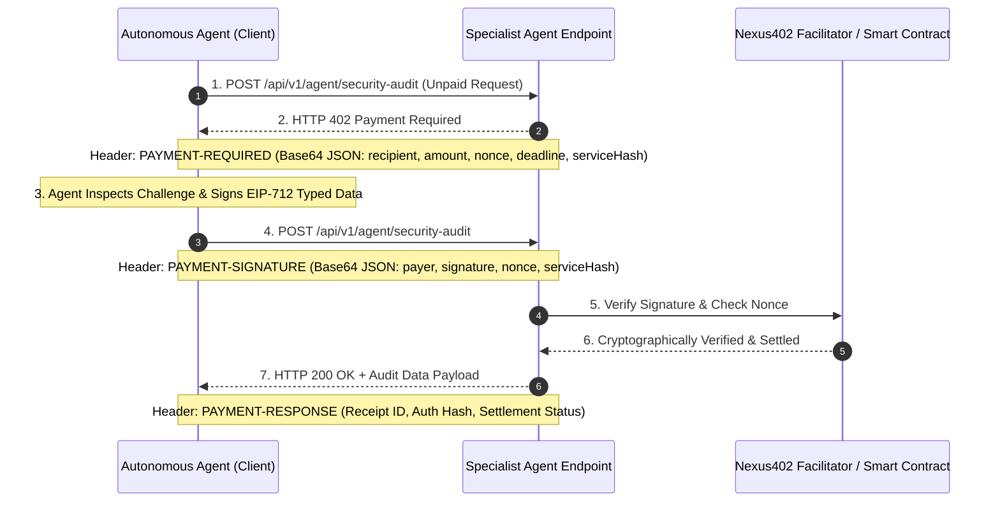

# ⚡ Nexus402: Autonomous AI Multi-Agent Service Mesh & SLA-Backed x402 Protocol

> **Submission for Loops House | Road to Devcon VIII (x402: Pay-Per-Call Track)**  
> *Enabling autonomous AI agents to dynamically negotiate, hire, verify, and settle micro-services with zero human custody, zero prepaid accounts, and cryptographic SLA escrow via HTTP 402.*

---

## 🌟 The Core Problem & Why x402 is Essential

Today's autonomous AI agents are trapped in a Web2 financial cage:
1. **No Credit Cards or KYC**: Autonomous software cannot obtain credit cards or pass human KYC checks.
2. **Subscription Fatigue**: An orchestrator agent cannot manage 50 separate monthly SaaS subscriptions for intermittent tasks.
3. **Custodial & Trust Bottlenecks**: When a master agent needs specialized capabilities (e.g. smart contract vulnerability auditing, opcode-level gas profiling, or ZK-SNARK solvency proofs), there is no standardized way to execute on-demand, machine-to-machine micropayments.

### The Nexus402 Solution
**Nexus402** resurrects the long-neglected **HTTP 402 ("Payment Required")** status code into an internet-native economic substrate. Using the **x402 open specification** and **EIP-712 structured cryptographic signatures**, autonomous agents can discover peer microservices, receive instant cryptographic challenges, sign payments autonomously with in-memory wallets, and receive verified receipts—settling seamlessly on Base / Ethereum.

---

## 🏆 What Makes Nexus402 Truly Unique? (Evaluation Highlights)

Unlike generic API paywalls (which simply put an HTTP 402 status on a basic weather or LLM prompt endpoint), **Nexus402** introduces groundbreaking architecture:

1. **Autonomous Multi-Agent Task Decomposition & Cascading x402 Swarm**:
   - A user submits a high-level mission (e.g. *"Audit Uniswap V4 Hook Vault, Profile EVM Gas, and Generate ZK Solvency Proof"*).
   - The **Master Orchestrator Agent (0xPrime)** decomposes the mission into a Directed Acyclic Graph (DAG) of subtasks.
   - It negotiates **3 concurrent HTTP 402 handshakes** across independent specialist agents:
     - 🛡️ **Valkyrie Security Sentinel** (`0.0250 USDC`): Static analysis, reentrancy detection, and formal logic threat scores.
     - ⛽ **Helios EVM Gas Optimizer** (`0.0150 USDC`): Storage slot packing, memory layout refactoring, cold SSTORE reductions.
     - 🔐 **ZeroMesh ZK-SNARK Prover** (`0.0400 USDC`): Groth16 / BN254 zero-knowledge solvency verification proofs.
   - Each transaction executes autonomously with zero human intervention.

2. **On-Chain Settlement & Batch Escrow Contract (`Nexus402Settlement.sol`)**:
   - **EIP-712 Cryptographic Verification**: Verifies off-chain signed machine authorizations without gas.
   - **Batch Settlement Engine**: Allows facilitators to aggregate dozens of micro-transactions into a single low-gas on-chain transaction.
   - **Replay Protection**: Cryptographic nonce tracking (`payer => nonce => isUsed`).
   - **SLA Escrow Staking**: Service providers stake collateral; faulty or timeout responses can be disputed.

3. **Live Protocol Inspector & Developer SDK**:
   - Inspect raw HTTP request/response headers: `402 Payment Required`, `PAYMENT-REQUIRED`, `PAYMENT-SIGNATURE`, `PAYMENT-RESPONSE`.
   - Complete `@nexus402/middleware` Express wrapper: protect any REST API in **3 lines of code**.
   - Autonomous client agent library: auto-detects 402, signs EIP-712, and retries.
   - Interactive Agent Wallet & Testnet USDC Faucet.

---

## 📐 System Architecture & x402 Handshake Sequence

```
+-----------------------------------------------------------------------------------------+
|                                    NEXUS402 MESH                                        |
+-----------------------------------------------------------------------------------------+
                                             |
                   User / Trigger: "Execute Audit & ZK Solvency"
                                             |
                                             v
                      +---------------------------------------------+
                      |       Master Orchestrator Agent (0xPrime)   |
                      |   - Embedded Autonomous EVM Wallet          |
                      |   - Dynamic DAG Task Planner & Budget Guard |
                      +---------------------------------------------+
                                     /       |       \
                                    /        |        \
                     (HTTP 402 Handshakes over RFC-402 Standard)
                                  /          |          \
                                 v           v           v
           +-----------------------+ +---------------+ +-----------------------+
           |   Valkyrie Security   | | Helios Gas    | | ZeroMesh ZK-SNARK     |
           |   Sentinel (/audit)   | | Optimizer     | | Prover (/zk-proof)    |
           |   Cost: 0.025 USDC    | | Cost: 0.015   | | Cost: 0.040 USDC      |
           +-----------------------+ +---------------+ +-----------------------+
                                 \           |           /
                                  \          |          /
                                   v         v         v
                      +---------------------------------------------+
                      |         Nexus402 Facilitator Engine         |
                      |   - EIP-712 Signature Verification          |
                      |   - Nonce Replay Check                      |
                      |   - Virtual Balance Ledger & Receipts       |
                      +---------------------------------------------+
                                             |
                                             v
                      +---------------------------------------------+
                      |   Nexus402Settlement.sol (Smart Contract)   |
                      |   - Base Sepolia / Ethereum L2              |
                      |   - Batch Settlement & Provider Escrow Stake|
                      +---------------------------------------------+
```

### The 4-Step x402 Protocol Flow



---

## 🛠️ Repository Structure

```
├── contracts/
│   └── Nexus402Settlement.sol       # Solidity smart contract (EIP-712, batch settlement, SLA escrow)
├── server/
│   └── src/
│       ├── protocol/
│       │   ├── x402Types.ts          # Core protocol schemas, headers, EIP-712 structs
│       │   ├── x402Facilitator.ts    # Facilitator engine, signature verification & ledger
│       │   ├── x402Middleware.ts     # Express middleware for HTTP 402 negotiation
│       │   └── x402Client.ts         # Autonomous Agent HTTP client with auto-signing
│       ├── agents/
│       │   ├── agentCatalog.ts       # Service definitions, pricing, SLAs, reputation
│       │   ├── specialistLogics.ts   # Security Auditor, Gas Optimizer, ZK-SNARK Prover engines
│       │   └── orchestrator.ts       # Master Swarm Orchestrator (DAG planner & dispatcher)
│       └── server.ts                 # Full API server & static client hosting
├── client/                           # Modern Cyberpunk Web3 Studio (React + Vite)
│   ├── src/
│   │   ├── components/
│   │   │   ├── Header.tsx            # Brand, wallet status, balance pill, testnet faucet
│   │   │   ├── SwarmVisualizer.tsx   # Interactive DAG graph with live pulse animations
│   │   │   ├── ProtocolInspector.tsx # Raw header inspector (402, Signature, Receipt)
│   │   │   ├── AgentMarketplace.tsx  # Catalog of agent services for individual testing
│   │   │   ├── WalletTerminal.tsx    # Keypair custody, balance tracker, receipts ledger
│   │   │   └── SDKDocs.tsx           # Developer integration guides (Express, Client, cURL)
│   │   ├── App.tsx                   # Main application
│   │   └── index.css                 # Custom glassmorphic cyber design system
├── tests/
│   └── x402Protocol.test.ts          # Vitest suite (challenges, EIP-712 signing, replay rejection)
├── scripts/
│   └── demo.ts                       # Headless CLI demo runner
├── package.json
└── README.md
```

---

## 🚀 Quick Start Guide

### Prerequisites
- Node.js >= 18.0.0
- npm >= 9.0.0

### 1. Installation
Clone and install all root and client dependencies:
```bash
git clone <your-repo-url>
cd <repo-folder>
npm install
npm --prefix client install
```

### 2. Run the Full Automated Test Suite
Verify that all cryptographic checks, challenges, EIP-712 signatures, and replay rejection mechanisms pass:
```bash
npm test
```
*Output: `✓ tests/x402Protocol.test.ts (4 tests passed)`*

### 3. Run the Headless CLI Demo
Experience the multi-agent swarm negotiating and settling via x402 right inside your terminal:
```bash
npm run demo
```

### 4. Launch the Interactive Web Studio
Start the fullstack application:
```bash
npm run server
```
Open your browser to: **[http://localhost:4020](http://localhost:4020)**

---

## 💻 Developer SDK Usage

### Protect ANY Express Route in 3 Lines
```typescript
import { requireX402Payment } from './protocol/x402Middleware.js';

app.post(
  '/api/v1/agent/security-audit',
  requireX402Payment({
    serviceId: 'agent-security',
    description: 'Autonomous Smart Contract Security Audit',
    recipient: '0x111111111111111111111111111111111111402A',
    amountMicroUnits: '25000', // 0.0250 USDC
    tokenSymbol: 'USDC'
  }),
  (req, res) => {
    // Only reachable when EIP-712 payment is verified!
    const receipt = req.x402Receipt;
    res.json({ success: true, data: "Audit findings...", receipt });
  }
);
```

### Consume with an Autonomous Agent
```typescript
import { AutonomousX402Client } from './protocol/x402Client.js';

const agent = new AutonomousX402Client(); // Uses in-memory private key

// Transparently negotiates HTTP 402, signs EIP-712 typed data, and retries:
const result = await agent.callEndpoint('http://localhost:4020/api/v1/agent/security-audit', {
  method: 'POST',
  body: { contractName: 'Vault.sol' },
  maxBudgetUSDC: 0.10
});

console.log('Result:', result.data);
console.log('Cryptographic Receipt:', result.receipt.receiptId);
```

---

## 📜 Smart Contract Specification: `Nexus402Settlement.sol`

- **Network Compatibility**: Base Sepolia / Base Mainnet / Ethereum L1 / Arbitrum
- **EIP-712 Domain Separator**: `Nexus402 Protocol v1.0.0`
- **Typehash**:
  ```solidity
  keccak256("PaymentAuthorization(address payer,address recipient,address token,uint256 amount,uint256 nonce,uint256 deadline,bytes32 serviceHash)")
  ```
- **Batch Settlement**: Facilitators aggregate 50-100 micro-invoices off-chain and commit `batchSettle(...)` on-chain in 1 transaction, saving 99%+ gas compared to single checkout transactions.

---

## 📄 License
MIT License. Open source and free for the Web3 and AI Agent community.
